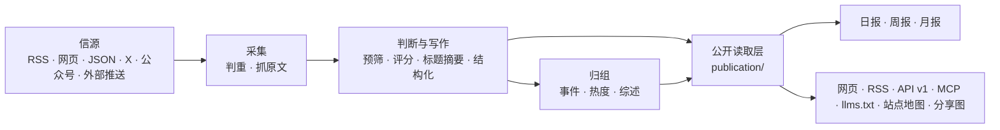

# 架构



## 三个进程

| 进程 | 位置 | 做什么 |
|---|---|---|
| api | `apps/api/` | Fastify。网站自用接口（`/api/site/`）、公开 API（`/api/v1/`）、RSS、MCP、后台接口、图片代理、分享图 |
| worker | `apps/worker/` | pg-boss 任务队列和定时任务：抓信源、调模型、归组、热度、日报、告警、清理 |
| web | `apps/web/` | React Router 服务端渲染的网页。只通过 HTTP 读 api，不碰数据库 |

业务代码都在 `packages/backend/`，前后端共用的类型和常量在 `packages/contracts/`。这个站自己的名字、文案、品牌和页面在 `site/`，行业的分类、信源、提示词和门槛在 `industry/`，只属于这个站的功能在 `modules/`（见下文“模块”）。

## 几条不变的规则

- **一个公开读取层**：网页、RSS、API、MCP、站点地图、分享图读的都是 `packages/backend/src/publication/`。公开范围、精选席位（机器出口每条新闻只出一条）与事实证据条件只在 `publication/scope.ts` 定义；新增出口也遵循当前的撤回和全文许可。已出刊报告保留当期写作，但引用是否可公开、来源名和引用时间仍按当前资料判断；撤回也要移除依赖该引用的导读与封面。
- **缓存不延长旧内容的寿命**：可变内容按响应的 `Cache-Control` 到期重新验证，站点地图的进程、磁盘与 HTTP 缓存共用同一个截止时间，不能在发送时重新计时；MCP 的 HTTP 响应使用 `no-store`。自建代理或 CDN 同样要遵守，配置要求见 [部署](deploy.md#配域名和-https) 的“配域名和 HTTPS”。
- **页面不调模型**：读者打开页面只读数据库里已经有的结果；模型只在 worker 的任务里调用。
- **花钱的请求有回执**：每个付费请求（模型、X、公众号、Jina）先记一张回执，拿到结果先存再用。进程重启、任务重试时，复用已经付过钱的结果，不重复花钱（`providers/receipts.ts`）。通常结果不明的回执超过 30 分钟后自动放行一次；因它停在失败状态的文章会重新入队，继续未完成的正文提取或分析。再次结果不明时，由管理员在“运行”页核对后放行。额度监控的采集和识别请求失败或结果未知时标记失败并中止本轮，不自动重试付费请求，不另采上下文；下一轮从上次整轮成功截止时间补齐，仍经过同一回执和预算检查。
- **预算熔断**：每个付费服务有每分钟、每小时、每天的上限，超过就暂停（后台“设置 → 付费请求上限”）。
- **安全阀**：`COLLECT_ENABLED`、`MODEL_CALLS_ENABLED`、`FEISHU_CONTENT_PUSH_ENABLED`、`FEISHU_INTERNAL_ENABLED`、`WEBHOOK_PUSH_ENABLED`、`INDEXNOW_SUBMIT_ENABLED` 只决定“发不发出去”，不决定走哪套逻辑；只有设成 `true` 才打开，没写就是关。`scripts/init-env.ts` 生成的 `.env` 会打开采集和模型调用，只调界面时可以改成 `false`；测试里推送一直关着，采集和模型调用只连本地假服务。
- **公开内容匿名**：管理员和访客看到的一样；读者的收藏、已读存在浏览器里。后台只允许管理员。
- **旧文不刷屏**：发现时已发布超过 48 小时的资料、新信源第一次导入的存量、回灌的推送，按原文时间归档，不进“今天”、不推送；第一次导入之后不再收列表里更早的存量。没有可信发布时间的资料先不公开，读到日期后再判断新旧。
- **来源可追溯**：每条精选都链接原文；站内是否显示全文由信源的 `site_fulltext` 决定，默认只显示摘要。
- **规则由所属模块维护**：后台调用内容、事件、通知与恢复模块，不直接改写它们的状态；业务模块不反过来依赖后台。人工修改、公开结果与恢复所需记录一起提交。
- **跨进程接口共享类型**：后台接口以 `packages/contracts/src/admin.ts` 为准，任务载荷以 `jobs/queue.ts` 的 `JobData` 为准，发送方和接收方一起检查。前端仍只通过 HTTP 访问后端。

这些模块边界由 `tests/architecture.test.ts` 检查；调整边界时同时更新约定与检查。站点身份和每一步的模型从 `site/` 读，行业分类和提示词从 `industry/` 读，代码里不写死某个站的值。

## 目录

| 位置 | 内容 |
|---|---|
| `site/` | 这个站自己的：站名文案、每一步的模型、品牌与 Logo、条款页、网站根目录的四个固定文件（`public/`，替换占位符后发布）、更新日志，以及启用哪些模块（`site/modules/`） |
| `industry/` | 行业包：分类标签、主题、示范信源、提示词、门槛 |
| `modules/` | 只属于这个站的功能，一个功能一个文件夹（见下文“模块”）；框架本身不带模块 |
| `packages/backend/src/sources/` | 六种信源的读取器，抓取调度（`collect.ts`） |
| `packages/backend/src/content/` | 资料入库、判重、正文提取和清洗 |
| `packages/backend/src/editorial/` | 判断与写作：`analyze.ts`（流程）、`prompts.ts`（读提示词）、`models.ts`（每一步用哪个模型） |
| `packages/backend/src/events/` | 事件归组、热度、事件综述 |
| `packages/backend/src/publication/` | 公开读取层 |
| `packages/backend/src/reports/` | 日报、周报、月报 |
| `packages/backend/src/providers/` | 模型、向量、X、公众号、Jina 的调用，回执与预算 |
| `packages/backend/src/notify/` | 飞书推送 |
| `packages/backend/src/operations/` | 告警、备份、清理、IndexNow |
| `packages/backend/src/admin/` | 后台接口 |
| `apps/web/app/routes/` | 每个页面一个文件，路由表在 `apps/web/app/routes.ts` |
| `database/migrations/` | 数据库迁移，按完整文件名排序执行和记账 |
| `scripts/` | 初始化、迁移、种子数据、评测、检查脚本 |
| `tests/` | 后端测试（数据库名必须以 `_test` 或 `_ci` 结尾，见下文） |

## 模块

框架里没有、只有你这个站要的功能（比如一个专门的榜单或监控页），做成模块：一个功能一个文件夹 `modules/<名字>/`，是一个名为 `@aihot/<名字>` 的 npm 包，装着它自己的后端、接口、页面、样式、数据库迁移和测试。

| 文件 | 内容 |
|---|---|
| `module.ts` | 它的地址：页面、跳转、交给 api 处理的路径（类型见 `packages/contracts/src/modules.ts`） |
| `server.ts` | 它接进后端的插口：接口、定时任务、队列、事件回调、后台页面的数据等（`packages/backend/src/modules.ts`，每个插口注明读它的文件） |
| `web.tsx` | 它接进网页的插口：页面、导航项、主题页与后台的部件等（`apps/web/app/modules.ts`）；只在某一页出现的部件给出加载函数，随那一页的代码加载 |
| `migrations/` | 它自己的表，和 `database/migrations/` 一起按文件名排序执行 |
| `tests/` | 它的测试，`npm test` 一起跑 |
| 其他文件 | 它自己的图片等静态文件也放在模块文件夹里：在 `server.ts` 的 `http` 插口里注册路由，用 `apps/api/src/routes/static.ts` 的 `sendFile` 发出（类型、ETag、缓存头和 404 都由它处理，文件名自己校验），地址写进 `module.ts` 的 `apiPaths` |

写好以后在 `site/modules/` 的三份清单里列上它：`index.ts` 列地址，`server.ts` 列后端，`web.ts` 列网页，没有的那份不列；再在 `site/package.json` 的 `dependencies` 里写上它。用 Docker 部署的，在 `Dockerfile` 里照着其他包加一行 `COPY modules/<名字>/package.json modules/<名字>/`。框架的代码不导入任何模块，只读这三份清单，所以合并本仓库以后的更新时，不容易和你自己的功能冲突。插口不够用时，在框架里加一个通用的插口，而不是把这个功能写进框架。

模块通过 `agent.abilities` 提供 MCP 工具。`scripts/mcp-check.ts` 始终检查完整工具集合；模块可在 `mcp.checkArgs` 中提供能在空数据库上成功的检查参数。未提供时，只有入参 schema 接受 `{}` 的工具会用 `{}` 实际调用；其余工具只检查发现，不猜参数。模块工具的业务行为由模块自己的测试验证。

模块公开投影登记在 `ServerModule.publications`，HTTP、Agent 和 MCP 出口通过 `packages/backend/src/publication/modules.ts` 的 `modulePublication` 读取。框架不导入模块实现，公开读取不触发采集或模型调用。

共享重置监控统一注册 `monitor` 模型能力和 `MONITOR_MODEL`，多个模块登记同一能力时合并请求用途，后台模型选择及统计覆盖全部监控。各 AI 配置只定义作者、提示词、入口和扫描频率，不单独选择识别模型；供应商频率使用共享预算控制。TwitterAPI.io 已在真实请求中返回免费套餐至少 5 秒的间隔要求，适配器在进程内固定等待 5.5 秒，失败不重试，不提供间隔环境变量。

本站安装 Codex 重置监控、Claude 额度动态与 Grok 额度动态，共用 `modules/reset-monitor/` 引擎。业务只有帖子 `monitor_source_posts`、事件 `monitor_event_records`、动作 `monitor_event_actions` 三张表，关系为事件包含动作、动作以 `sources: [{postId}]` 引用帖子，不另存帖子事件绑定或动作来源表。动作以事件内 `sequence` 保持事实顺序，来源发布时间只用于公开排序和缺明确业务时间时的时间依据。必要运行记录存 monitor_state。各产品只保留定义、产品策略和薄入口，来源时间解析由共享引擎完成；新监控不复制实现或另建产品表。所有访问限定服务端 monitor_id，引用核验归属，公开出口统一通过 publication 读取 v2。

通用非事件规则由共享引擎处理，产品专属规则通过 `excludeProposition` 校验每条模型命题，保留结构化编号和排除原因，原始响应只留内部付费回执。排除命题不参与事件或关联；全部排除且无故障线索时归为无关，混合消息继续逐项处理，人工可更正自动结论。

三个监控统一支持 `direct_reset`、`reset_credit`、`bonus_credit`，账号、默认产品、公开目录及套餐放 `site/reset-monitors.ts`。帖子保存来源、作者、发布时间、七语言标题摘要、链接、原文 text、单层随帖引用 quoted_post 及必要处理记录，不存全文翻译或供应商原始 JSON。运行识别、引文和时间核验直接读取帖子；原文与引用分开，引用不能代替外层帖子动作依据。原文只供后台管理员读取，不进入事件、动作、公开响应或业务审计。供应商原始响应保留在内部付费回执，用于计费与请求续处理；历史恢复正文仅由离线转换工具核验既有回执或旧帖子。

动作只属于一个事件，以 sources 引用多个帖子；帖子事件关系从动作汇总，不另存绑定。sequence 是事件内事实顺序，增删来源不改变重放顺序。九类动作决定状态，不从摘要猜状态。范围统一保存在事件，事件变更、动作更正、来源和顺序调整分开表达，一次事务提交；版本核验及锁仅涉及相关记录。新事件必须有预告或确认，没有有效初始动作停止公开。

帖子 processing_status 只有 pending、processed、needs_attention、failed，表达识别进度，保留 review_reason、不维护 manual。有无相关事实从动作来源判断。worker 仅处理 pending，结果写入核验原始版本和 pending 状态，人工处理后的过期任务不能覆盖新结果。动作或来源管理不改变识别进度；明确完成帖子处理后设 processed 并清空原因，翻译仅补文案。

监控站点、Agent、MCP、飞书与 Webhook 统一消费 v2；`updates` 是动作并完整返回 `{postId,sourceId,url}` 来源数组。站点只通过 HTTP 读取，日历显式使用 `Asia/Shanghai`。监控 v1、旧站点快照和轮询接口、原文弹窗及相关专属类型删除，不保留兼容模式；其他新闻 v1 保留。契约见 [公共额度接口 v2](reset-monitor-v2.md)。

配置修改后重启生效。新增或重新添加账号的观察起点在请求前持久化，失败不漂移；旧账号沿成功截止补齐，不跳过停机窗口。按真实回复、引用关系组织识别组，每组一次模型调用并逐帖校验证据；context_only 辅助材料不独立识别，不生成官方动作。已有处理结果只作上下文，组结果一次事务保存。平台独立配置 collection.includeReplies（回复他人）、includeSelfReplies（自回复）、resetOnly 和关键词，主帖始终开启；本站三个平台开启自回复，回复他人与关键词过滤关闭。两个回复开关均关闭时仅主帖，只开一个时加采对应类别，两者都开时加采全部回复；回复类别交由第三方查询筛选，本地解析、去重并保存，不因目标账号缺失丢弃帖子；纯转推由查询排除。过滤采用关键词 OR 查询和现有模型确认，采集策略只在后端绑定读取，不进入浏览器定义。reply_to 保存回复目标，引用对象保留自身回复关系；上下文先复用本轮与已存材料，仍缺失时按明确 ID 付费补采；filtered_out 独立于识别进度，明确无关记录保留但默认隐藏，人工保留或成为动作来源时解除。补采的外部作者和窗口外材料只作上下文，不自动生成历史事件；不重筛已完成记录，不重置成功截止。worker 使用统一来源解析器和 Temporal，PST 固定 UTC−08:00，PT 按 America/Los_Angeles 夏令时规则，无作者预测或发放惯例；公开业务时间只取动作明确事实或动作发布时间。

AI 模块须在包依赖中声明 `@aihot/reset-monitor` 才能导入共享引擎；模块不能互相导入其他 AI 模块，共享引擎不能反向导入 AI 模块。共享引擎不在站点清单中作为独立功能安装。

主信源通过非空 `authors` 列表配置账号和显示名，各账号依次完整采集，全部采集及识别成功才推进检查点；文案补全校验转复核不阻断截止。默认产品只补缺失值，不覆盖已有事件和人工字段。Grok 初始 `@bot`、`@grok` 分别默认 Grok Bot 和 Grok 普通额度。本版仅支持当前动作结构，不提供旧监控库的原地转换；旧结构部署需按[重新部署与数据导入](deploy.md#重新部署与数据导入)从已核验的当前结构备份恢复到空库。迁移执行器会在应用待执行迁移前检查删表目标，非空表拒绝删除；运行时不探测旧表。

## 数据库迁移

### 站点定时任务

`site/site.ts` 的 `DEPLOYMENT.queues` 是全部业务队列与定时队列的白名单：`null` 允许全部，数组只允许其中名称，空数组全部停用。生产者、框架消费者、模块消费者及定时注册共用 `queueEnabled` 检查；禁用队列的生产请求报明确的站点配置停用错误，不创建队列。`DEPLOYMENT.engineSchedules` 另列启用的框架定时任务，仍须通过队列白名单。

本站 `engineSchedules=[]`，队列白名单只有 `cron.monitor.tick`、`cron.claude-reset.tick`、`cron.grok-reset.tick`。这三个 cron 即使采集或模型调用安全阀关闭也保留定义，执行时由监控任务自身检查安全阀。其余新闻处理、翻译、Webhook、运维和报告消费者及定时任务均不注册；不把独立翻译、Webhook 或其他停用任务并入监控 tick。通用能力保留在框架中，其他站可按自己的队列及定时清单启用。框架测试通过显式测试配置开放队列，站点任务测试使用本站真实白名单，不按 `NODE_ENV` 绕过。

pg-boss 自己维护的 `__pgboss__send-it` 是定时投递内部队列，不是额外业务任务，不经过业务白名单，也不能为满足“三个任务”而删除。本站数据库应有三个业务队列、三个业务调度以及必要的 pg-boss 内部队列。

worker 启动和运维同步共用同一份任务定义。同步会删除已停用的 `cron.*` 队列、调度及其执行作业，保留非 cron 业务队列、`job_runs` 和付费回执；不能仅手工删除数据库调度，否则旧配置会在重启后重新生成。`scripts/reconcile-schedules.ts` 默认只读预览，`--apply --worker-stopped` 仅在操作者已停止全部 worker 后同步，不启动任务处理器、pg-boss 调度或维护循环，也不迁移数据库。

已经发布的迁移是部署历史，不能改写或删除；修正放进新的文件。引擎和模块的迁移遵循同一套约定：按完整文件名排序执行，并以完整文件名记录是否已经执行；编号相同的不同文件分别执行，同一完整文件名不能出现在两个目录中。从 `0055` 起，每个文件只放一条允许在线执行的语句，PR 会拒绝不符合约定的新增迁移，也不允许用较小编号绕过检查。这样避免前一条语句锁住表后，又在同一事务里等待别的表或扫描大量数据。

新增列优先使用可空列或常量默认值；给已有表加 CHECK、外键时先 `NOT VALID`，再用另一个迁移验证。索引使用单独的 `CREATE INDEX CONCURRENTLY IF NOT EXISTS`；不能在发布迁移里做大批 UPDATE、DELETE 或用 DO 隐藏它们。数据回填需另做分批、可观测的操作，并先在备份副本上验证。

主键调整可先并发建立唯一索引，再用单条 `ADD CONSTRAINT ... PRIMARY KEY USING INDEX ...` 安装。执行器须在持有表锁的事务内检查索引属于目标表、有效、唯一、非部分或表达式索引，且每列已有 NOT NULL；不允许借此触发全表 NOT NULL 扫描。旧主键移除之前必须已有等价唯一索引，涉及复合外键时先建立并验证新外键。旧代码的冲突目标会失效时，升级期间暂停写入，更新全部实例后恢复。

多个筛选条件存在相关性、查询计划因此严重低估行数时，可以为这些列创建 MCV 联合统计，再用单独的迁移 `ANALYZE` 指定表的这些列。先用真实分布验证收益；不增加没有依据的统计对象，也不在迁移里做全库分析或跳过被锁住的表后假定成功。

改类型、删列等破坏性变更需要单独设计升级与回退步骤，在 [部署文档](deploy.md#更新) 说明对已有数据的影响。代码已不再使用的列，确认可以删除后，单独一个迁移文件写 `ALTER TABLE <表> DROP COLUMN IF EXISTS <列>`；代码已不再使用的空表，单独一个迁移文件写 `DROP TABLE IF EXISTS <表>`。在线删表迁移在应用待执行文件前检查目标表是否非空，非空则拒绝整批迁移；执行时持有表锁再次检查，防止检查后写入造成数据丢失。已有数据的处置须先单独备份、演练及批准，不通过删表迁移隐式清空。两者均不带 CASCADE，仍有对象依赖时迁移失败，同样在部署文档里写明。其他未允许的破坏性语句不会直接通过在线迁移检查；需要扩展允许的语句时，先证明它不会长期阻塞正在服务的请求，并补齐相应检查，不能关闭检查或修改旧账本。

## 对外出口

| 地址 | 内容 |
|---|---|
| `/` `/all` `/hot` `/topics` `/daily` `/weekly` `/monthly` | 精选、全部动态、热门事件、主题、日报周报月报 |
| `/feed.xml` `/feed/full.xml` `/feed/all.xml` `/feed/daily.xml` `/feed/weekly.xml` `/feed/monthly.xml` | RSS：精选、精选全文、全部、日报、周报、月报；另有按分类的 `/feed/category/<key>.xml` 和分类全文版 `/feed/full/category/<key>.xml` |
| `/api/v1/` | 公开 API，文档在 `/openapi-v1.json`；给 Agent 读的 Markdown 从 `/api/v1/agent` 开始；说明页在 `/agent` |
| `/api/v2/overview`、`/api/v2/<平台>-resets` | 额度监控总览与动作事件列表，静态说明 `/openapi-v2.json` 由模块共享契约生成；v1 说明保留新闻接口，仅移除监控路径及孤立 schema |
| `/api/mcp` | MCP 服务：最新、搜索、热点、事件、日报、周报、月报各一个工具，工具名前缀是 `site/site.ts` 的 `mcpPrefix` |
| `/llms.txt` `/sitemap.xml` `/robots.txt` | 给大模型和搜索引擎的说明（`robots.txt` 等根目录文件在 `site/public/`） |
| `/admin` | 后台 |

## 测试

```bash
npm run typecheck
DATABASE_URL=postgres://127.0.0.1:5432/myhot_test npm test
npm run build -w @aihot/web && node --test apps/web/tests/*.test.ts
```

`DATABASE_URL` 指向的库名必须以 `_test` 或 `_ci` 结尾；没有会自动创建并迁移。每个测试文件在它的一份副本上并行运行，所以数据库账号要有建库权限（`CREATEDB`）。测试不访问任何外部服务：模型和付费接口都由本地假服务回答。
